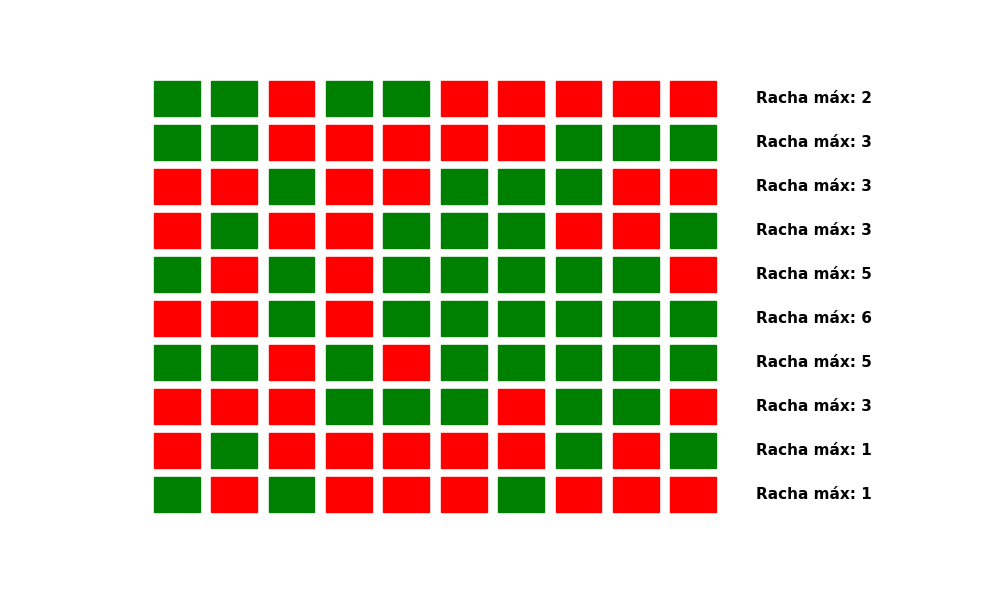
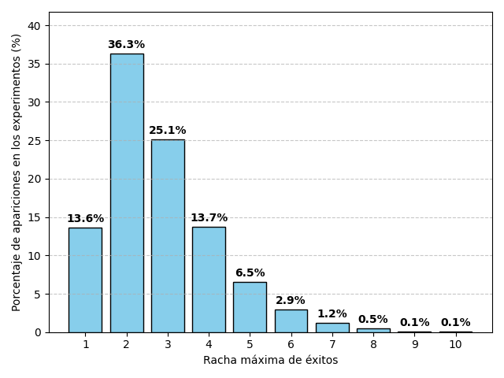
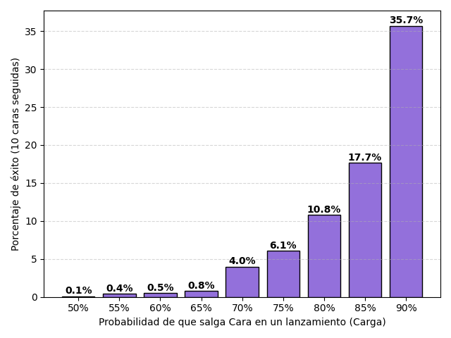

# Simulaciones
> *La piedra filosofal*

Una simulación nos permite alejarnos de lo abstracto y tocar lo
complejo. Esta herramienta es la columna vertebral del libro y por eso
es importante empezar por aquí.

Usemos un ejemplo simple: lanzar una moneda.[^1] Todos sabemos que
existe una probabilidad $p=0.5$ de obtener `cara` o `cruz` (ambas
opciones son igualmente probables), y en este ejemplo `cara` cuenta como
un éxito. Ahora, yo pregunto: ¿cuál es la cantidad máxima de éxitos
seguidos que podemos obtener al realizar diez lanzamientos? Esto se
puede resolver de forma analítica con multiplicaciones y potencias, pero
ese camino no le interesa a nadie.

Lo más divertido que podemos hacer es programar una moneda y lanzarla.
Hacemos diez lanzamientos para un experimento y repetimos el experimento
mil veces. Con esto, vamos a tener una buena aproximación a la
distribución de probabilidad de obtener $n$ éxitos seguidos.

Tenemos una moneda digital que obtiene `cara` o `cruz` con una
probabilidad del 50%. Vamos a realizar 10 lanzamientos como podemos ver
en la figura [-@fig-lanzamientos], y luego hacemos este mismo proceso
durante mil experimentos para contar cuántos éxitos seguidos obtuvimos
(figura [-@fig-experimentos]). Finalmente, vamos a ver la distribución
de esas rachas para ver el máximo de éxitos seguidos que podemos esperar
si lanzamos una moneda 10 veces.

{#fig-lanzamientos width="80%"}

{#fig-experimentos width="80%"}

El resultado es que después de mil experimentos vamos a poder contar
cuántas veces aparecieron $n$ éxitos seguidos, dividirlo entre mil y
tener una probabilidad aproximada:

$$\hat{P}(\text{racha de } n) = \frac{f(n)}{1000}\,,$$ donde $\hat{P}$
es la probabilidad aproximada de obtener $n$ éxitos seguidos, y $f(n)$
es la frecuencia de nuestras rachas (cuántas veces apareció esa racha en
los experimentos).

Antes de mostrarte las probabilidades me gustaría preguntarte qué tan
probable crees que es obtener sólo éxitos en 10 lanzamientos. Dame un
número del 1 al 100. Espero que lo tengas en mente cuando te revele la
verdad. En la figura [-@fig-n-monedas] puedes ver el resultado de la simulación. La
probabilidad de obtener `cara` más de 5 veces seguidas se vuelve casi
imposible, menos del 5%. Lo más probable es obtener 2 y 3 éxitos
seguidos, hasta 4 resulta razonable, pero más allá de esos valores,
estamos en el mundo de la fantasía.

{#fig-n-monedas width="80%"}

Hay un acertijo que pregunta ¿cuál es la probabilidad de obtener `cara`
si ya lanzamos una moneda 10 veces y todas salieron `cara`?, y la gente
se siente tentada a decir que lo más probable es que salga `cruz`, para
estabilizar la cuenta. Con una moneda normal, sabemos que la
probabilidad se mantiene en 50%, porque cada lanzamiento es
independiente. No importa si ya obtuviste `cara` 10 o 100 veces, la
moneda no lleva la cuenta. Sin embargo, con lo poco probable que es
obtener 10 éxitos consecutivos, podemos empezar a dudar de que se trate
de una moneda normal. Se vuelve viable que se trate de una moneda
cargada.

Aunque el acertijo se haga para un entorno teórico perfecto, nosotros no
vivimos en un mundo teórico perfecto. Si una moneda se lanza 10 veces y
sale `cara` 10 veces, ahí hay truco. De hecho, podemos hacer una nueva
simulación con monedas cargadas para ver qué tan probable es obtener 10
éxitos seguidos si tenemos una moneda que salta a nuestro favor.

{#fig-monedas-cargada width="80%"}

Los resultados están en la figura
[-@fig-monedas-cargada]. Observa que incluso con una carga del
90% ($p_{\text{cara}}=0.9$), obtener 10 éxitos consecutivos apenas
alcanza la probabilidad del 35%. Por lo que si alguien te pregunta qué
es más probable, que salga `cara` o `cruz`, después de que salió cara 10
veces seguidas, puedes decir con mucha confianza que lo más probable es
que salga `cara`, porque la moneda debe estar cargada para obtener esos
resultados.

De esta manera cerramos el capítulo, hemos observado el poder de las
simulaciones, y también he establecido mi intención con este libro: hay
que analizar los problemas más allá del escenario teórico que no se
presenta nunca. Si el acertijo de arriba fuera una apuesta con sumas
importantes de dinero, el teórico que se pasa de listo diciendo que la
moneda no lleva la cuenta iría a la quiebra. Nuestra intuición nos dice
que algo anda mal con obtener 10 éxitos seguidos, hay que escucharla.
Sobrevivir es más importante que tener la razón.

Para finalizar, quiero agregar que otra ventaja de hacer simulaciones es
que nos permite construir un entorno de conocimiento completo, donde
sabemos todo lo que se puede saber sobre él, a diferencia de lo que pasa
en el mundo real. Entonces, como conocemos la respuesta verdadera que
oculta la aleatoriedad, podemos comparar el resultado de los modelos con
la realidad más exacta. Lo cual no ocurriría si usáramos datasets
abiertos de internet, porque no conocemos la distribución que sigue el
mundo y cualquier estimación que hagamos puede meternos en el problema
del pavo. No importa qué índice de error usemos para medir los
resultados de un modelo, sólo contamos con lo que hemos observado. Por
otro lado, una simulación nos ofrece algo sólido para medir nuestros
modelos y ver cuáles sobreviven. Y ya que la vida no nos permite ver sus
secretos, podemos asumir que un modelo que se comporta mal en una
simulación va a ser peor en el mundo real.

[^1]: Esta y todas las simulaciones presentes en el libro se encuentran
    en los archivos adjuntos o en el repositorio de GitHub oficial. No
    incluiré código en este libro porque hoy ni siquiera hace falta
    programar, lo único que debes hacer es tener la lógica de la
    simulación bien estructurada y pedirle a un chatbot que lo programe.
