# El promedio
> *Ingenuidad y manipulación*

El promedio es la herramienta estadística más conocida, y también nos
resulta la más natural, pues la usamos desde que entramos a la escuela.
Nuestra experiencia con el promedio nos indica que puede usarse como
resumen de un conjunto de datos, ya que si tienes un estudiante con un
promedio de 9 sobre 10, concluyes que se trata de uno bueno sin
necesidad de ver todo su historial.

Debido a esto, podemos llegar a malinterpretar lo que significa un
promedio cuando se trabaja con datos que no muestran la estabilidad de
las calificaciones escolares. Veamos un ejemplo de esta estabilidad. Si
eras un chico que obtenía 8 en todas sus tareas y exámenes, un único 0
no causaba un colapso de tu nota final, como un 10 no te convertía en el
mejor de la clase. Podemos verlo en este ejemplo:

$$\frac{8.5+8.25+7.75+9+7.5+8+8+8.5+7.75+\mathbf{0}}{10} = \mathbf{7.33}\,,$$
$$\frac{8.5+8.25+7.75+9+7.5+8+8+8.5+7.75+\mathbf{10}}{10} = \mathbf{8.33}\,.$$

Ir de un extremo al otro equivale a un punto de diferencia, lo cual
puede parecer mucho cuando eres un niño que intenta impresionar a sus
padres, pero en términos prácticos, se trata de ruido.

Las cosas cambian cuando hablamos de dinero, un tema que le interesa a
todo el mundo. Ya que la distribución del dinero muestra enormes
desigualdades, usar esta métrica es una estrategia de manipulación común
para venderte sueños imposibles.

Un ejemplo clásico es este anuncio que me aparece en cada rincón de
internet: obtén un sobresueldo de $x$ dinero haciendo trading, o
comprando esto, o vendiendo aquello. Cuando vas a los detalles te
advierten que esos valores son el promedio obtenido de un grupo de
pobres diablos que intentaron el mismo método inútil que quieren
venderte. Veamos por qué se trata de una mentira.

Puedes tener a noventa y nueve personas con una ganancia anual nula y a
una única persona con un aporte gigante de un millón:

$$\frac{99 \times 0 + 1\,000\,000}{100} = 10\,000\,.$$

Luego, podrías escuchar que el método te consigue una ganancia anual
promedio de unos fabulosos $\$10\,000$. Y concluyes (erróneamente) que
lo mejor que puedes hacer es adquirir el curso que te están vendiendo.

Por eso, mi intención con este capítulo es abrirte los ojos ante la
amenaza de darle demasiada importancia a un promedio si no conoces la
naturaleza de la variable que estás analizando. No es lo mismo hablar de
un promedio limitado por el mundo físico, que de uno que trabaja sobre
sistemas de información.

## Cuando el promedio es el héroe

Pongamos un ejemplo donde el promedio tiene sentido: queremos estimar el
consumo medio diario de gramos de carne en un local de hamburguesas del
barrio. Esto nos permite planificar gastos, y en este escenario tiene
todo el sentido del mundo usar un promedio como estimador porque nunca
vas a tener cien clientes que consuman una hamburguesa junto a uno que
consuma mil.

Es posible que la estimación tenga pequeñas explosiones inesperadas
(como tener el restaurante lleno), pero sigue estando limitado por un
sistema físico (el tamaño del restaurante). No puedes pasar de cero a un
millón en un minuto.

En este sentido, lo único que hace falta es la desviación estándar.
Ninguna media tiene sentido sin su varianza. Bajo una campana de Gauss
perfecta, tienes alrededor de un 68% de la información dentro de una
desviación estándar hacia arriba y hacia abajo.

Para entenderlo mejor, hagamos una simulación. La cantidad de gramos que
contiene cada hamburguesa está estandarizada: una hamburguesa normal
tiene 125 g, una premium tiene 200 g, y una hamburguesa doble tiene
250 g.

Luego asignamos probabilidades razonables para cada hamburguesa: la
probabilidad de que un cliente compre una hamburgusea normal es
$p_{\text{hnormal}} = 0.5$, la de que compre una premium es
$p_{\text{hpremium}} = 0.3$, y para llegar a 1, la de una hamburguesa
doble tiene que ser $p_{\text{hdoble}} = 0.2$.

Esto signficia que cuando un cliente se para frente al cajero, tiene una
probabilidad $p_i$ de ordenar una de esas hamburguesas, donde
$i \in \{\text{hnormal}, \text{hpremium}, \text{hdoble}\}$. Lo que se
traduce en que la probabilidad de comprar una hamburguesa disminuye al
incrementar el precio, algo que tiene todo el sentido del mundo.

Con estas probabilidades, utilizamos una distribución normal
$\mathcal{N}(20, 5^2)$ para simular la entrada de clientes durante las 5
horas que el local está en funcionamiento. Esta distribución tiene una
media de 20 con una desviación estándar de 5, y el local tiene una
capacidad máxima de 30 clientes por hora. Esto significa que la mayor
parte del tiempo, el local va a tener entre 15 y 25 clientes cada hora,
pero si llega a tener más, nunca van a ser más que 30 (límites físicos).

Puedes entender esto gráficamente en la figura
[-@fig-consumo-horas]. La figura representa un único día de
trabajo. La cantidad de clientes está relacionada con el consumo de
carne, como es de esperarse, pero como la elección de los clientes
también implica aleatoriedad, a veces puede haber menos clientes, pero
más consumo de carne. En cualquier caso, podemos ver que el día inició
con local lleno, tenemos 30 clientes, que es el máximo que puede haber
cada hora. Luego, la cantidad de clientes baja, pero vemos que este día
nunca llega a 10, lo cual resulta muy poco probable.

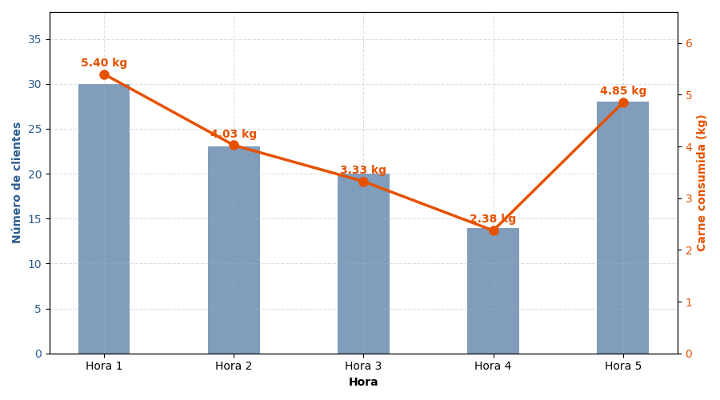{#fig-consumo-horas width="80%"}

Ahora podemos simular un mes y recopilar datos. Primero, tenemos un
consumo diario individual: $$C_d = \sum_{i=1}^{N} X_i\,,$$ donde $C_d$
es el consumo total de gramos de carne de un día, $N$ representa el
número total de hamburguesas vendidas ese día, y $X_i$ representa los
gramos que contiene cada hamburguesa vendida (que puede ser normal,
premium o doble según su probabilidad). Así, obtenemos valores de 30
días para calcular un promedio de consumo diario con su desviación
estándar: $$\bar{C} = \frac{1}{30} \sum_{d=1}^{30} C_d\,,$$
$$s = \sqrt{\frac{1}{30} \sum_{d=1}^{30} (C_d - \bar{C})^2}\,.$$

Es decir, durante cinco iteraciones (cinco horas de funcionamiento),
generamos clientes de forma aleatoria que van a elegir una hamburguesa
según su probabilidad $p_i$, luego sumamos los gramos de carne que
contiene cada hambruguesa elegida a un total de consumo diario $C_d$, y
repetimos este experimento 30 veces para obtener los valores de un mes.
Finalmente, calculamos el promedio diario con su desviación estándar
para decidir cuánta carne vamos a comprar.

El resultado de esta primera simulación es visible en la figura
[-@fig-c1-consumo-mes], tenemos el total de carne consumida en
kilos cada día. Esos valores los dividimos para 30 y obtenemos un
promedio de 16.52 kg, con una desviación estándar de 1.87 kg. Puedes
observar que el promedio junto a sus desviaciones estándar para arriba
y para abajo consiguen abrazar a la mayoría de los valores obtenidos
durante ese mes. Hay unos pocos picos hacia arriba y hacia abajo, pero
esas excepciones tampoco se alejan demasiado de lo esperado. Esto es lo
bello de trabajar en entornos físicos limitados que siguen las leyes del
universo.

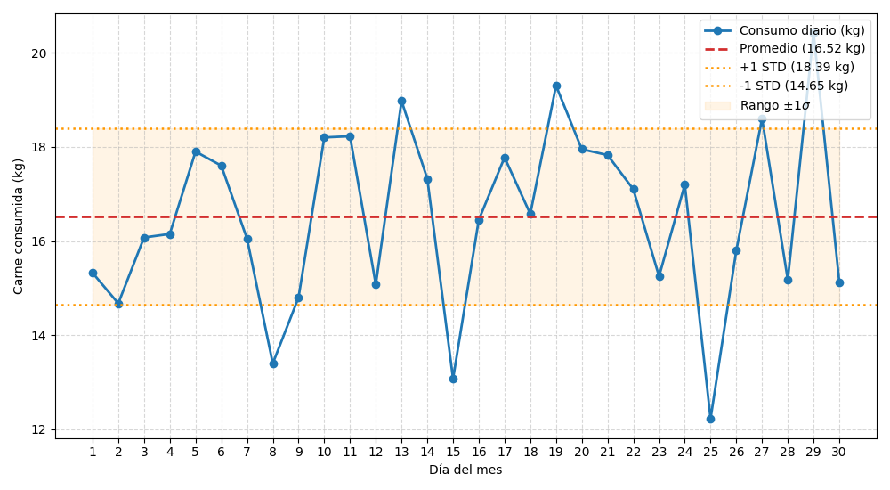{#fig-c1-consumo-mes width="80%"}

Podemos imaginar estos datos como el monitoreo que hacemos de un local
en el mundo real. Vemos cuántos clientes entran y cuántas hamburguesas
se preparan durante un mes y obtenemos estos resultados: la media
muestral es de 16.52 kg con una desviación estándar de 1.87 kg. Como la
desviación es menor de 2 kg, creo que lo mejor es concentrarse en el
promedio obtenido.

Ahora, debemos tomar una **decisión de negocio**: el resto del año vamos
a comprar la carne de forma semanal, y vamos a comprar el valor promedio
diario multiplicado por 7. Algo importate a tomar en cuenta es que en
este mundo imaginario la carne sólo se vende por kilos enteros y cuesta
$\$10$ el kilo.

Entonces, tenemos que $16.52 \times 7 \approx 115$, por lo tanto, vamos
a comprar 115 kg todas las semanas. Eso equivale a un gasto semanal de
$\$1150$. Finalmente, aplicamos la técnica del foodcost al 20% 
(los ingredientes representan el 20% del precio final del producto). Aunque
sólo se venden kilos enteros, nosotros podemos estimar el valor de los
gramos para nuestras hamburguesas. Luego tomamos ese valor y lo
multiplicamos por 5. Esto nos da como resultado que las hamburguesas van
a costar:

$$\begin{align*}
    1\text{ kg} &= 1000\text{ g}\,, \\
    1\text{ kg} &= 10\,\$\,, \\
    1000\text{ g} &= 10\,\$\,, \\
    \text{precio\_hnormal} &= \frac{125\text{ g}}{1000\text{ g}} \times 10\,\$ \times 5 = \mathbf{6.25}\,\$\,, \\
    \text{precio\_hpremium} &= \frac{200\text{ g}}{1000\text{ g}} \times 10\,\$ \times 5 = \mathbf{10.00}\,\$\,, \\
    \text{precio\_hdoble} &= 6.25\,\$ \times 2 = \mathbf{12.50}\,\$\,.
\end{align*}$$

Con estos precios, y estableciendo que el comportamiento de los clientes
se va a mantener estable el resto del año, veamos qué tal le va a esta
estrategia comercial. Vamos a analizar algunos puntos fundamentales para
decidir si la estrategia funciona. ¿Estamos generando ganancias? Sin
ganancias netas, nada tiene sentido. ¿Nos está sobrando carne? Porque si
nos sobra mucha carne cada semana estamos comprando de más y
desperdiciando recursos. Y finalmente, si no nos sobra, ¿se nos acaba
rápido y nos obliga a cerrar el negocio? Tampoco resulta práctico
comprar muy poco y fallarle a los clientes.

::: {#fig-c2-ganancia-neta layout-ncol="2"}

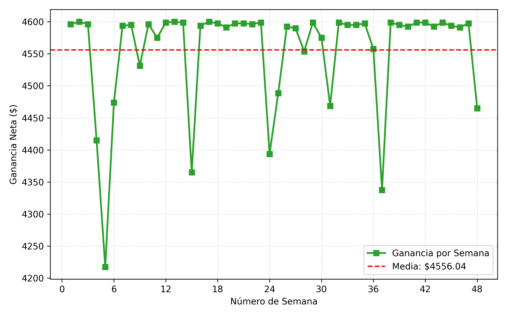{#fig-ganancia-linea-tiempo}

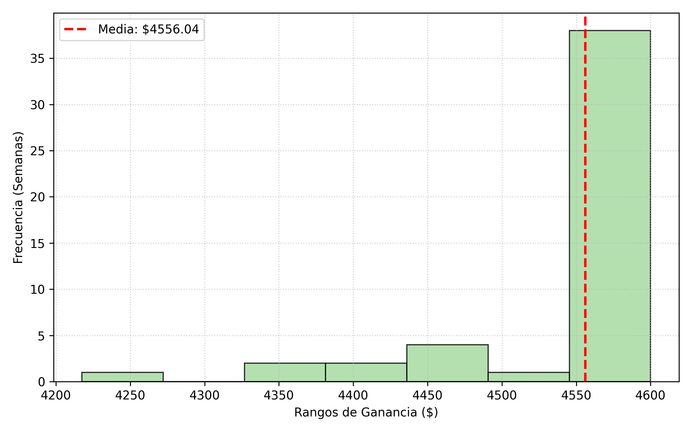{#fig-ganancia-histograma}

Ganancias netas durante un año de trabajo.
:::

La figura [-@fig-c2-ganancia-neta] muestra las ganancias netas a lo largo
del año y lo que tenemos es una ganancia constante que siempre supera
los 4 mil dólares semanales.[^1] Esto significa que usar el promedio
como estimador por lo menos sí nos resulta rentable. No nos hizo falta
analizar series de tiempo ni aplicar estadística avanzada, un promedio
centrado en factores físicos nos resultó confiable. También puedes ver
que las ganancias ya no se comportan como una distribución normal.
Tenemos un bloque altamente concentrado en la parte alta de las
ganancias. Es decir, la mayor parte de las semanas la ganancia es
superior al promedio de $\$4,523$, pero hay semanas donde la ganancia se
cae. Veremos cómo nos afectan distribuciones asimétricas con valores
extremos en más profundidad en el próximo escenario.

Ahora hay que analizar el consumo de carne. ¿Estamos comprando demasiado
y podemos ahorrar unos dólares? La figura
[-@fig-c2-sobras] nos
muestra que la carne sobrante puede alcanzar algunos picos de 8
kilogramos, pero la mayor parte del tiempo, terminamos la semana sin
nada. Esos pocos picos de sobras se pueden convertir en el almuerzo
familiar o en una donación para los últimos clientes, la verdad es que
no representan un problema considerando las ganancias.

::: {#fig-c2-sobras layout-ncol="2"}

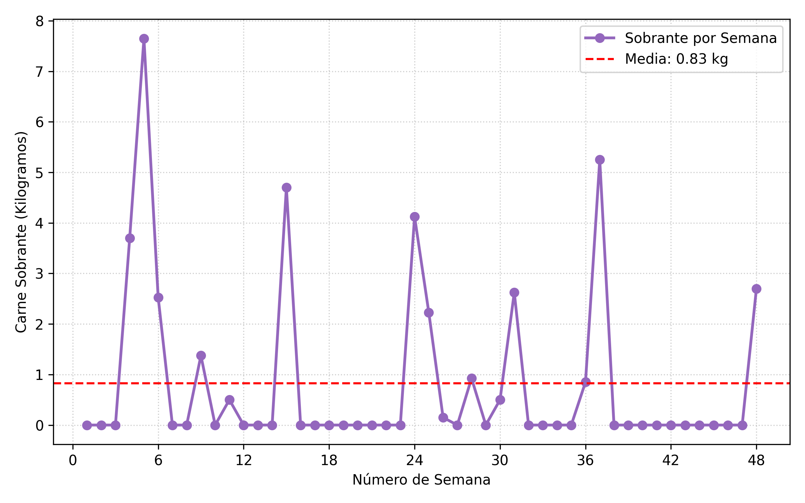{#fig-ganancia-linea-tiempo}

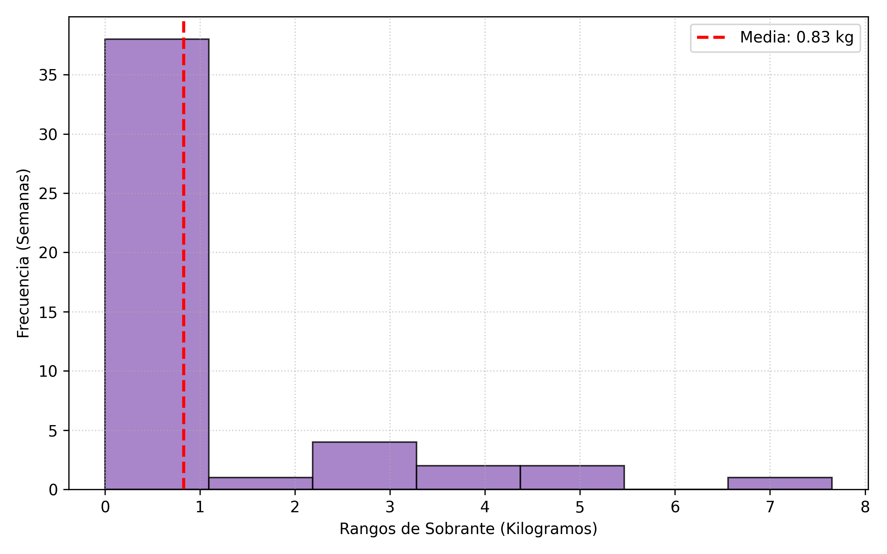{#fig-ganancia-histograma}

Cantidad de carne que sobra después de terminar la semana laboral.
:::

Finalmente, la carne se nos acaba la mayor parte del tiempo, ¿pero
tenemos suficiente para satisfacer a nuestros clientes todos los días?
Primero hice un análisis de los datos generados para ver qué día de la
semana se acababa la carne, todos los resultados dieron como respuesta
el domingo. Así que podemos confiar en que la cantidad de carne que
compramos es suficiente para cumplir con nuestra semana laboral. Si el
domingo cerramos temprano por falta de ingredientes no podemos
culparnos, el domingo es un día de relajación. La figura
[-@fig-c2-quiebre]
nos muestra a qué hora suele terminarse la carne, podemos observar que
sólo hubo un domingo en el que tuvimos que cerrar el local después de la
primera hora. La mayor parte del tiempo la carne se termina en la hora 4
y 5, sobre todo en la 5. Es decir, las semanas que no nos sobra carne,
podemos atender el local los domingos sin problema, si cerramos unos
minutos antes, no pasa nada.

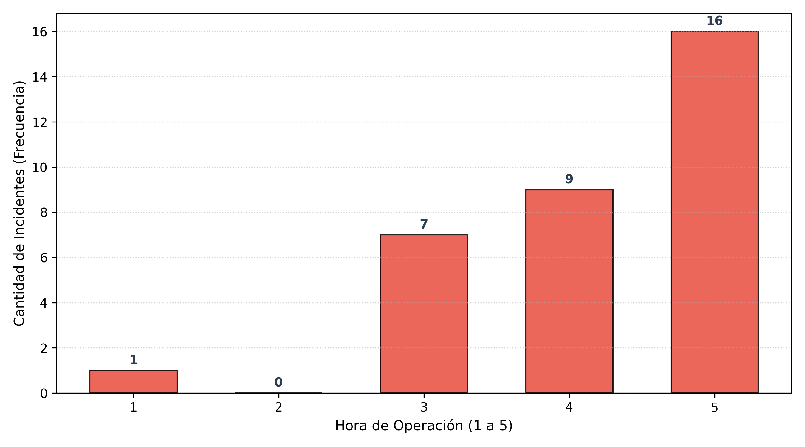{#fig-c2-quiebre width="80%"}

Con esto cerrramos nuestro primer escenario, ideal para el promedio. Ya
que estamos tratando con variables limitadas por el mundo físico: carne
que puede consumir un cliente y cantidad de clientes dentro del local,
el promedio encuentra esa estabilidad que necesita para brillar. Ni
siquiera tomamos en consideración las desviaciones estándar, usamos el
modelo más simple posible. Y tal vez creas que se pueden mejorar las
predicciones con un modelo más complejo, volveremos a esta cuestión más
adelante, pero déjame adelantarte que no se puede. Por ahora, después de
haber visto el promedio brillar, es momento de ver su caída.

## Cuando el promedio es el villano

En nuestro siguiente escenario vamos a abandonar la seguridad del mundo
físico y navegaremos los temibles y turbulentos mares de la información.
Vamos a seguir con nuestro local de hamburguesas, para no romper la
magia que creamos hace poco, y lo único que vamos a cambiar es el
sistema para hacer los pedidos.

Queremos que nuestras hamburguesas nos den la libertad financiera, así
que nos expandimos al mundo online para poder entregar pedidos hechos en
aplicaciones de comida a domicilio. Igual que antes, queremos estimar
cuánta carne debemos comprar cada semana. Igual que antes, hacemos un
estudio preliminar del promedio de pedidos que se realizan en estas
aplicaciones. La gran derrota es que no analizamos la distribución de
esos pedidos.

El escenario está construido de esta manera. Las grandes cadenas de
hamburguesas como McDonald's o Burguer King se llevan el 80% de los
pedidos, mientras que los locales de barrio como el nuestro sólo se
reparten el 20%. Esto es lo que se conoce como ley del 80/20. La
competencia de barrio la dejé en 27 locales, parece un número razonable.

Luego, la cantidad de usuarios que hacen pedidos de hamburguesas por
hora la modelé con una distribución normal $\mathcal{N}(150, 20^2)$, en
general podemos esperar que haya entre 130 y 170 personas pidiendo
hamburguesas cada hora. Sin embargo, la mayoría de esos usuarios (el
80%) va a realizar un pedido en una gran cadena. Esto significa que
nosotros deberíamos pensar en un promedio de $150 \times 0.2 = 30$
(¡repartidos entre 27 locales de barrio!), como un estimador sencillo,
pero vamos a irnos por el lado ingenuo para demostrar que el promedio
nos puede arruinar.

Dejemos correr la simulación y adoptemos el punto de vista del dueño de
local ingenuo que mira una página de estadísticas de sitios web. Igual
que en el escenario anterior, lo que queremos es un promedio diario para
multiplicar por 7 y comprar la carne para la semana. Vemos una página de
estadísticas web y nos enteramos de que se realizaron un promedio de 743
pedidos por día en el último mes. Con esa información lo que hacemos es
dividir este número de pedidos para la cantidad de locales de
hamburguesa que en hay la ciudad (incluyendo las grandes franquicias), y
encontramos que debemos esperar unas 24 hamburguesas diarias
($743/30 = 24.77$).

Si esperamos 24 hamburguesas diarias, vamos a tener que comprar carne
para llegar a 168 ($24 \times 7 = 168$). Digamos que en la aplicación
sólo vamos a poner la hamburguesa normal, nada de premium ni doble,
tenemos control sobre eso, y no queremos complicarnos la vida. Si
nuestra hamburguesa normal tiene 125 g, entonces vamos a comprar 21 kg
de carne cada semana ($125 \times 168 = 21\,000$). Ahora que hemos
tomado nuestra decisión, veamos cómo nos va.

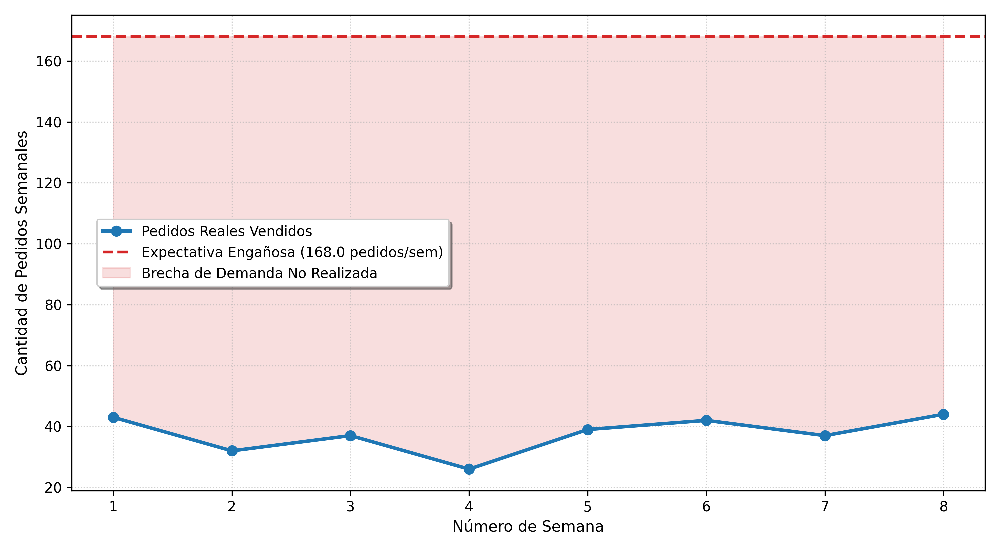{#fig-c2-expectativa width="80%"}

Nosotros esperábamos conseguir alrededor de 168 pedidos semanales, sin
embargo, durante dos meses hemos visto cómo la realidad nos golpeaba
semana a semana. Por ese motivo, detenemos el experimento y hacemos
cuentas de los daños. La figura
[-@fig-c2-expectativa] nos muestra la diferencia entre nuestro
estimador y los pedidos que conseguíamos en la aplicación. Nunca
llegamos ni a la mitad de lo que habíamos estimado, lo cual, ya podemos
deducir, se traduce en un desperdicio de comida y de dinero.

::: {#fig-c2-tragedia layout-ncol="2"}

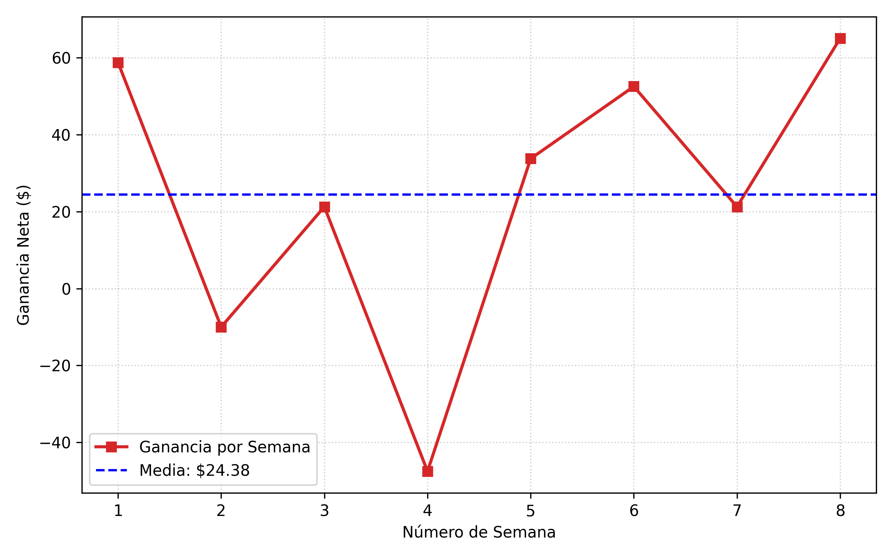{#fig-tragedia-dinero}

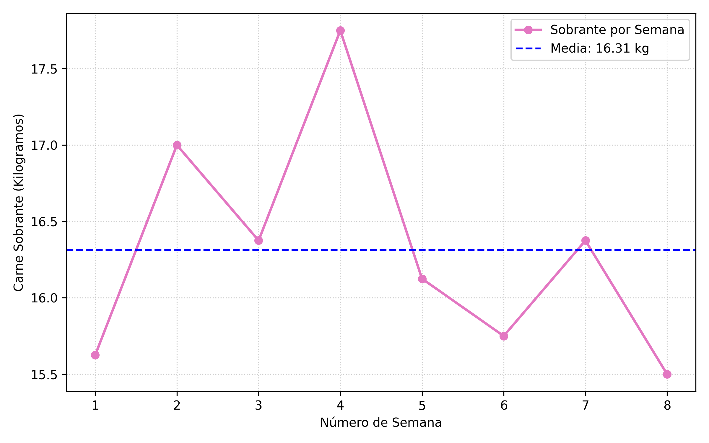{#fig-tragedia-carne}

Resultados de nuestro estimador (promedio) ingenuo.
:::

En la figura [-@fig-c2-tragedia] podemos observar que nuestro estimador nos
perjudicó de lo lindo. Por un lado (figura
[-@fig-tragedia-dinero]), vemos que nuestras ganancias no son
constantes, de hecho, hay semanas en las que tenemos pérdidas
considerables. Por el otro (figura
[-@fig-tragedia-carne]), tenemos más de 15 kg sobrantes cada
semana. Con eso podemos hacer muchas hamburguesas y lo estamos tirando a
la basura.

Curiosamente, cuando vemos el balance total de estos dos meses, tenemos
una ganancia neta de $\$195.00$. Esto es gracias a que el food cost al
20% es una estrategia que permite mantener un restaurante. Sin embargo,
estos $\$195.00$ extra (extra porque ya antendemos a nuestros clientes
dentro del local con buenas ganancias) no justifican el desperdicio de
comida. Además, existe la posibilidad de que hayamos tenido suerte, si
el experimento seguía, íbamos a terminar con pérdidas.

¿Cómo hubiésemos podido evitar caer en esta trampa? Lo primero hubuiera
sido entender la distribución de los datos. A diferencia de lo que
pasaba en nuestro local de hamburguesas, los pedidos que se realizan en
una aplicación no tienen limitaciones. Las grandes franquicias, debido a
su popularidad, concentran la mayor parte de los pedidos, y no hay
ningún límite físico o natural que evite que los usuarios soliciten
todos sus pedidos a aquellas franquicias que les gustan, ignorando a
todos los demás.

Como analistas, debemos ver cómo se reparten los datos más allá de un
promedio diario. De haberlo hecho en este escenario, hubiéramos
encontrado que, quitando las grandes franquicias, el resto de locales
luchan por el 19.8% de los pedidos (figura
[-@fig-distribucion-pedidos]).

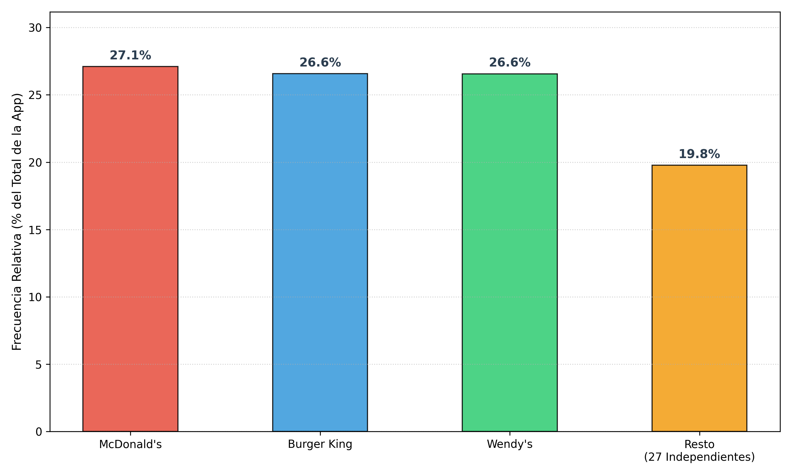{#fig-distribucion-pedidos width="80%"}

Con esta información, como mínimo hubiéramos bajado nuestras
expectativas. Como máximo, hubiéramos usado el promedio de pedidos
repartido entre 28 locales ($27+1=28$ porque también consideraríamos el
nuestro). Claro, antes de tomar esta decisión, hay que asegurarse de que
no haya desigualdades entre estos 27 locales de barrio. La figura
[-@fig-distribucion-pedidos-locales] nos muestra que, quitando
las grandes franquicias, tenemos una distribución bastante uniforme
donde algunos tienen un poco más, otros un poco menos, pero se ve cierta
estabilidad en la cual podríamos confiar los primeros meses.

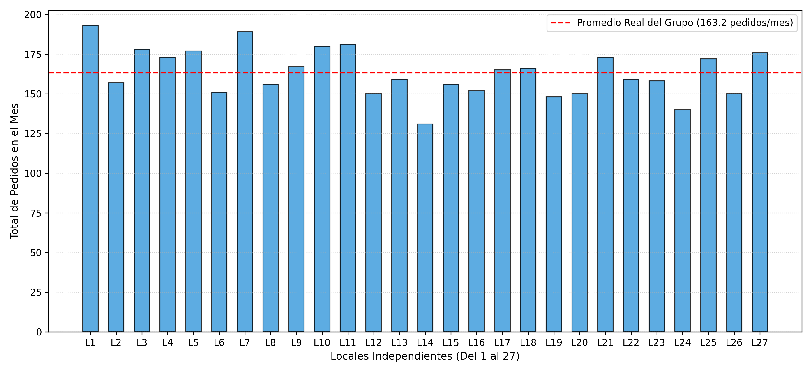{#fig-distribucion-pedidos-locales width="80%"}

Así nos despedimos de este gran capítulo. Nuestro primer capítulo usando
simulaciones para entender las fortalezas y debilidades de un modelo
estimador. De esta manera, espero dejar clara mi metodología, y que en
los próximos capítulos podamos adentrarnos en los análisis de modelos
más complejos, teniendo completamente claro en qué consiste una
simulación.

[^1]: Esto puede parecer mucho, pero antes de lanzar tu hamburguesería
    considera que tener un par de empleados, la renta del local, y otros
    improvistos que incluyen impuestos, seguros y gastos sorpresa;
    reduce tu ganancia personal a unos $\$800$ si tienes suerte.
