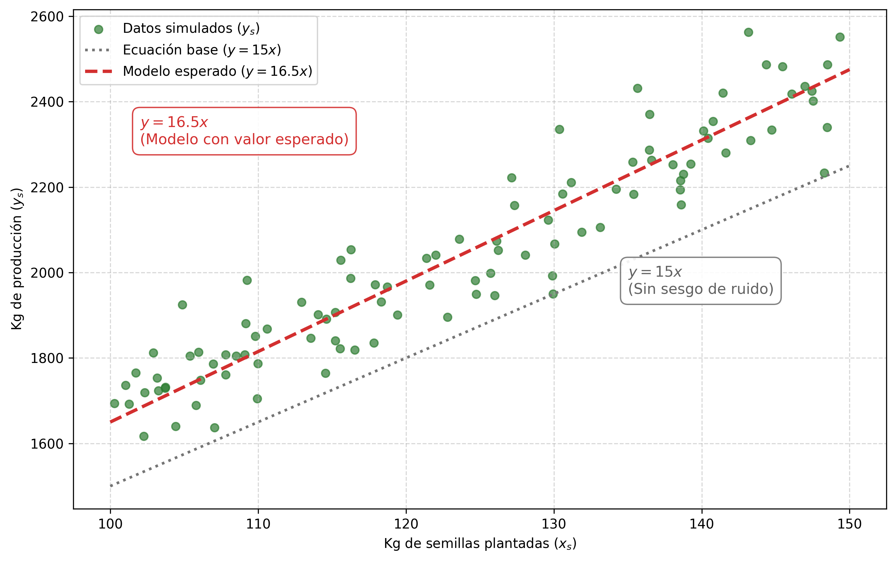
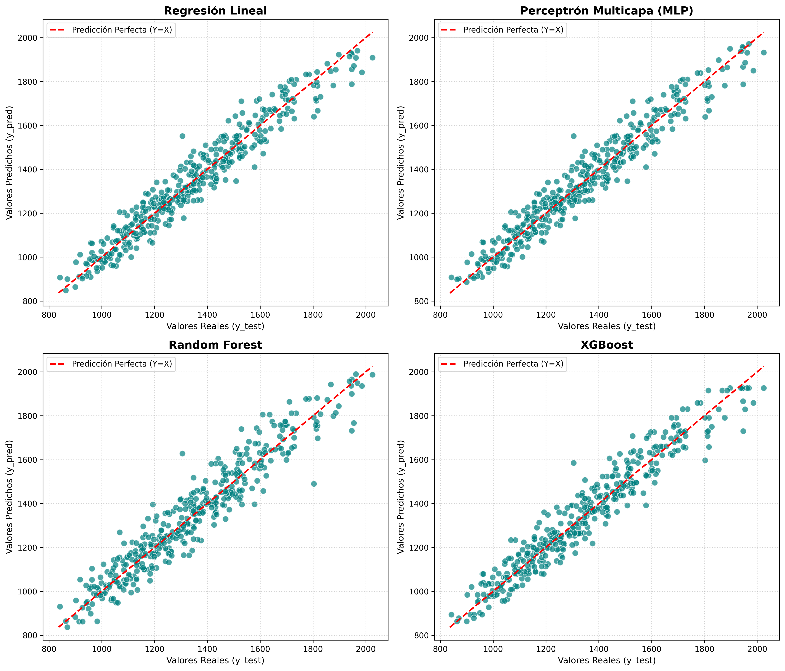
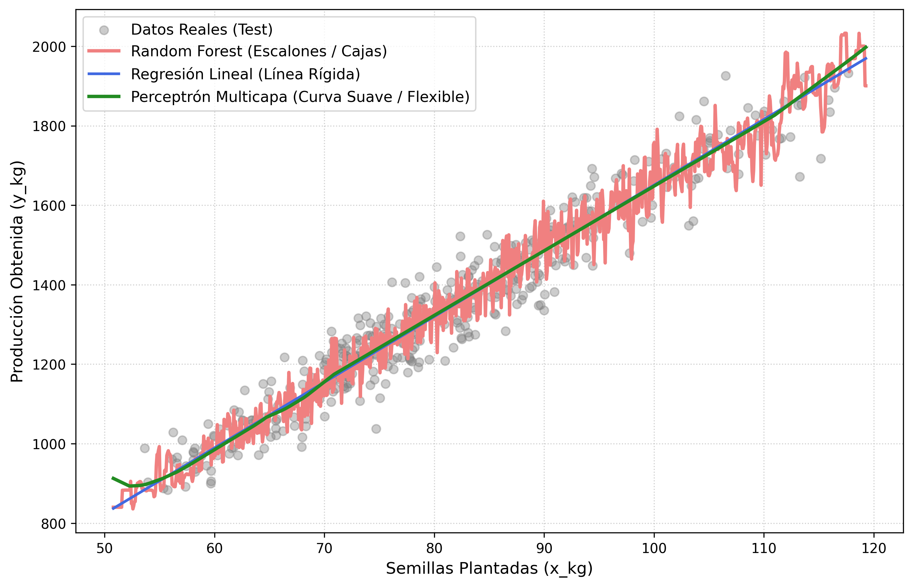
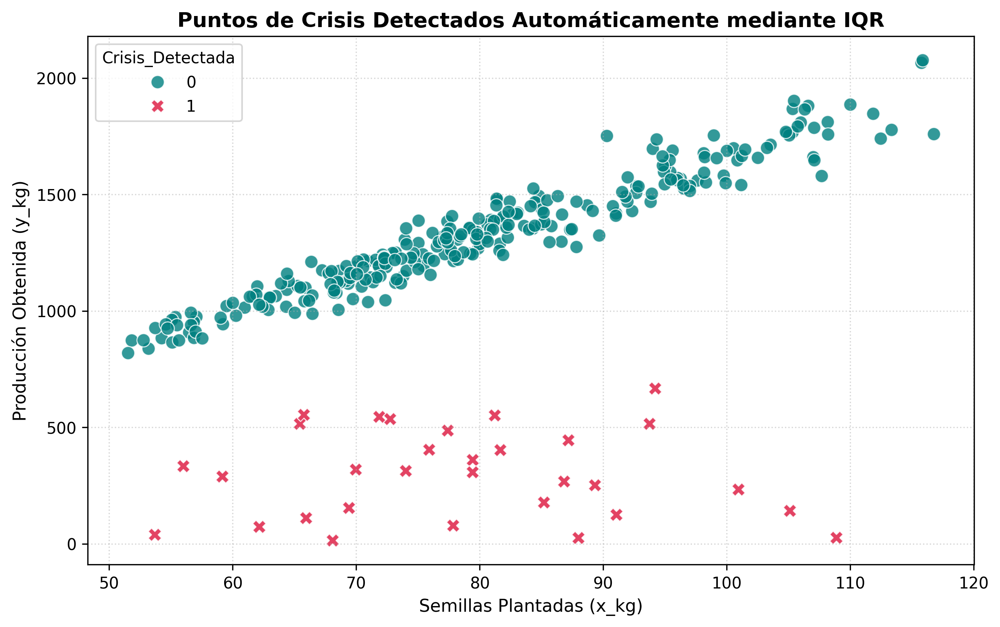
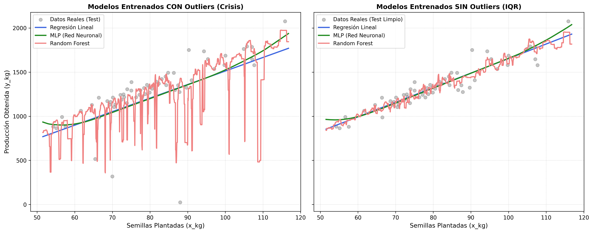
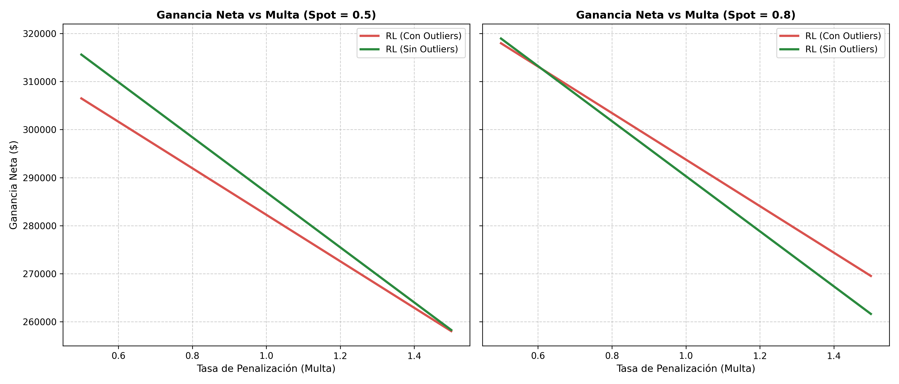

# Relaciones lineales
> *Es lineal o nada*

Uno de los primeros descubrimientos que hice cuando inicié mi carrera en
la publicación científica fue que los modelos más complejos no suelen
justificar su complejidad. Una simple regresión lineal suele ser
suficiente para la mayoría de los desafíos, y si no lo es, debes rezar
para que los datos tan siquiera puedan ser modelados.

## Una corta explicación de mis modelos favoritos

Los modelos que voy a usar en este capítulo van a aparecer en varias
ocasiones y vale la pena que tengamos un marco de trabajo común en caso
de que no los conozcas. No voy a adentrarme en definiciones profundas
porque no es necesario, sólo hace falta entender por qué los seleccioné
sobre todos los otros modelos que hay.

Primero tenemos un random forest (bosque aleatorio), se trata de un
modelo que utiliza muchos árboles de decisión para obtener un estimado
más robusto. Un árbol de decisión toma un conjunto de datos y lo divide
para maxizar la predicción correcta de una característica. Por ejemplo,
podemos tener un árbol que divide a los clientes de un banco según su
riesgo crediticio. Un bosque aleatorio combina varios de estos árboles
entregando muestras del dataset al azar para que cada árbol aprenda algo
diferente. Luego se toman todos los valores predichos por los árboles y
se hace un promedio. El random forest resulta ser una de las mejores
opciones para casi cualquier problema. Recomiendo usarlo como base.

El XGBoost es una variación del bosque aleatorio que no me interesa
mucho, pero es muy popular, mucha gente toma el XGBoost como modelo
base. Yo prefiero el random forest, se supone que el XGBoost tiene unas
cuantas ventajas, pero en mis investigaciones no ha hecho la diferencia.

Finalmente, la red neuronal es el modelo definitivo. Voy a usar un
perceptron multicapa clásico sólo porque me interesa tener un modelo
complejo para que compita con los más simples. Quizá en un capítulo
futuro utilice otra arquitectura, pero por ahora no hace falta. Si no
conoces el funcionamiento de una red neuronal, generalmente se suele
tratar como una caja negra, donde las predicciones no se pueden
interpretar del todo.

Sólo queda decir que si ordenamos los modelos por complejidad (qué tanto
cómoputo requieren, qué cantidad de datos, y qué tan fácil es
intrepretar sus resultados) podemos hacerlo de esta manera: random
forest (el más simple), XGBoost y la red neuronal (el más complejo). Con
esta presentación es suficiente para seguir adelante.

## El país de las maravillas

Empecemos con un escenario ideal. Tenemos una relación lineal
completamente estable donde una variable independiente $x$ genera una
variable dependiente $y$, que involucra un factor de ruido aleatorio que
sigue una distribución normal:

$$\begin{equation}
    y = \beta x \left( 1 + \frac{\epsilon}{100} \right)\,,
\end{equation}$$ donde $\epsilon \sim \mathcal{N}(10, 5^2)$. Para evitar
lo abstracto, imaginemos un escenario concreto. Como quiero usar una
distribución normal, nuevamente debemos pensar en términos físicos. Vale
la pena repetir que sería tonto asumir una distribución normal en un
sistema de información.

El escenario que quiero presentarte es el siguiente: tenemos unas
plantaciones agrícolas cuya producción queremos predecir para poder
cerrar contratos por adelantado. Nuestro problema consiste en que
necesitamos una cifra cerrada en cientos de kilos de producción para
poder firmar un contrato. Es decir, el comprador nos exige garantizarle
$y_s$ cientos de kilos de producción para poder firmar el contrato. Si
no cumplimos, recibimos una multa, pero también podemos producir de más
y que ese producto no se venda porque el comprador no tiene la capacidad
para manejar el excedente.

Entonces, la única información que tenemos es la cantidad de kilos de
semillas que hemos plantado en nuestras tierras. Y la idea es predecir
nuestros kilos de producción teniendo como entrada nuestros kilos de
semillas sembradas. La producción puede ser cualquier cosa: café,
sandías, maíz, arroz; no importa. Ya que tenemos un escenario anclado al
mundo físico resulta razonable pensar en una relación lineal donde más
kilos de semillas plantadas se traducen en más kilos de producción. Esta
relación es la que vamos a modelar con la ecuación que presenté antes:
$$\begin{equation}
    y_s = \beta_s x_s \left( 1 + \frac{\epsilon}{100} \right)\,.
\end{equation}$$

Le agrego el subíndice $s$ porque hacemos referencias a las semillas: la
cantidad de producción en kilos $y_s$ sigue una relación lineal con la
cantidad de semillas plantadas $x_s$. Por supuesto, esta ecuación es
desconocida en el mundo real, ésta es la estructura invisible que
queremos descubrir usando nuestros conocimientos en ciencias de datos. A
este escenario ideal vamos a darle un $\beta_s$ = 15, es decir, por cada
kilo de semillas sembradas, deberíamos obtener 15 kilos de producción.
Como el mundo no sigue una línea recta perfecta, necesitamos agregarle
ruido. Ahí es donde entra nuestro $\epsilon$.

Este factor de ruido sigue una distribución normal
$\mathcal{N}(10, 5^2)$, lo que significa que nos va a entregar un valor
de entre 5 y 15 la mayor parte del tiempo, y entre 0 y 20 casi el 98% de
las veces (cosas de la distribución normal). Este ruido se divide para
100 y se suma uno porque lo que buscamos es tomar la relación lineal
perfecta y provocarle una pequeña variación porcentual.

En otras palabras, nuestra producción va a seguir la relación: 15 kilos
de producción por cada kilo sembrado, con un ruido aleatorio que hace
que la producción varíe entre un 5% y un 10% extra la mayor parte del
tiempo. Por ejemplo, sembramos 1 kg hoy, y en seis meses en lugar de
producir 15 kg, obtenemos 15.75 kg, que es $15 + (15\times5\%)$; en otro
terreno obtenemos 16.5 kg, que es $15 + (15 \times 10\%)$; y en el
último conseguimos 15.15 kg, que es $15 + (15 \times 1\%)$. Puedes ver
que cada elemento entre paréntesis representa el ruido aleatorio.

Así, obtenemos una variación realista que nos permite modelar esta
producción agrícola en base a una relación lineal. Para que puedas
digerirlo, te presento una gráfica donde mostramos la cantidad de
semillas plantadas vs la producción, todo en kilos, considerando 100
plantaciones diferentes (figura
[-@fig-c3-produccion-semillas]). Puedes observar que los kilos
producidos no son una línea recta, a veces hay más, a veces hay menos,
como todo en la vida.

{#fig-c3-produccion-semillas width="80%" fig-pos="htbp"}

Cada punto en la figura
[-@fig-c3-produccion-semillas] representa un terreno diferente
donde se plantaron $x_s$ kg de semillas. También agregué una línea que
representa nuestra relación perfecta de 15 kilos producidos por cada
kilo plantado. Y finalmente agregué un modelo ajustado donde se sumó el
valor esperado a los 15 kg iniciales
($\hat{y}_s = (15 + 1.5)x_{s} = 16.5x_{s}$). Este modelo ajustado
representa el mejor modelo que podríamos obtener conociendo todo lo que
se puede conocer sobre la realidad que estamos modelando. Nos servirá de
referencia cuando entrenemos nuestra regresión lineal, pero por ahora
podemos ignorarlo, pues esta información es desconocida en el mundo
real.

Ahora vamos a una simulación de producción. Controlamos una cantidad $n$
de hectáreas donde cada una permite sembrar una cantidad variable de
semillas. El objetivo de estas variaciones es que los modelos tengan
múltiples opciones para inferir la regla general. Finalmente, estos
terrenos sólo se pueden cultivar cada 6 meses, así que tampoco es que
contamos con una cantidad ilimitada de datos. Vamos a simular 10 años de
producción para 100 hectáreas mantiendo estable el comportamiento de los
terrenos (no se deterioran). Y esto nos da un total de 2000 registros
($100 \times 20$) para entrenar nuestros modelos.

Luego, hacemos un típico proceso de producción donde separamos el 80% de
los datos para entrenamiento y el 20% restante para métricas de error.
En estas condiciones, podemos evaluar los modelos a través de un gráfico
muy ilustrativo. La figura
[-@fig-c3-comparacion-pred-real] muestra una comparativa entre
las predicciones de los modelos y los valores reales en el conjunto de
pruebas. La línea roja representa una relación perfecta donde los puntos
por encima indican que el modelo predijo un valor superior al real y los
puntos por debajo que el modelo predijo un valor inferior.

{#fig-c3-comparacion-pred-real width="80%" fig-pos="htbp"}

A primera vista, no hay una gran diferencia entre los modelos. Los
puntos del random forest se ven algo más dispersos, pero resulta difícil
confiar sólo en nuestro ojo. Necesitamos recurrir a algo más concreto.
Sin embargo, antes de avanzar quiero destacar los valores que presentan
los ejes del gráfico, la producción de nuestros terrenos se encuentra
entre los 800 kg y los 2000 kg, lo que implica que una diferencia
inferior a 100 kg se puede considerar ruido.

Y es ruido lo que encontramos al medir los índices de error. Los
resultados de las métricas más típicas se encuentran en la tabla
[-@tbl-rendimiento-test-set]. El RMSE y el MAE están en kilos, y ninguna
diferencia entre los modelos supera al menos los 100 kg. A pesar de que
el modelo lineal y la red neuronal obtuvieron mejores resulados que los
bosques aleatorios, la diferencia sigue siendo muy pequeña. Con esto
parece claro que no vale la pena elegir otra cosa que no sea un modelo
lineal de toda la vida.

| Modelo | RMSE | MAE | $R^2$ Score |
|:---|---:|---:|---:|
| Regresión Lineal | 63.1500 | 50.5687 | 0.9371 |
| Perceptrón Multicapa (MLP) | 63.1714 | 50.5960 | 0.9370 |
| Random Forest | 79.1799 | 62.8786 | 0.9011 |
| XGBoost | 66.4085 | 52.7134 | 0.9304 |

: Comparativa de rendimiento en el test set {#tbl-rendimiento-test-set}

Probemos otro punto de vista. Voy a llenar cada modelo con una línea de
puntos para ver cómo se comporta. El gráfico de la figura
[-@fig-c3-comparacion-linea] muestra que la red neuronal se
esfuerza por comportarse como una regresión lineal, mientras que el
árbol aleatorio tiene varios puntos de quiebre y su inestabilidad no
representa nada valioso porque el ruido que se produce alrededor de la
línea recta es aleatorio y no se puede predecir.

{#fig-c3-comparacion-linea width="80%" fig-pos="htbp"}

Para finalizar esta sección, veamos cómo luce la ecuación deducida por
la máquina para compararla con nuestra realidad oculta:
$\hat{y}_s = 16.46x_{s} + 3.01$. Como puedes ver, esta aproximación es
muy cercana a nuestro modelo de conocimiento completo:
$\hat{y}_s = 16.5x_{s}$. Si existiera una relación lineal en el fondo de
nuestros datos, en principio, no hay nada mejor para modelarla que una
regresión lineal simple. Los modelos más complejos como random forest (o
XGBoost) tratan de modelar el ruido, lo cual es imposible y la red
neuronal se comporta como una regresión lineal, pero sin su
interpretabilidad (es una caja negra). Ahora agreguemos algo de caos al
asunto.

## Cuando la crisis toca a tu puerta

Lo más interesante no es analizar qué pasa en las condiciones ideales,
sino qué pasa cuando inyectamos algo de caos y destrucción. Por lo
tanto, veamos qué pasa cuando el 10% de nuestros ciclos de producción
sufren una catástrofe. ¿Por qué el 10%? Es un número arbitrario, pero
bajo. Si fuera más alto seguramente implicaría una imprevisibilidad
demasiado incómoda para mantenerse en el negocio. No. Nuestra producción
es predecible la mayor parte del tiempo, pero nadie puede saberlo todo.

El 10% de las veces, en lugar de tener una correspondencia lineal, vamos
a tener enormes caídas. Para ser preciso, voy a colocar una ruleta que
va de 0 a 50, esta ruleta determina el porcentaje de la producción
final. Es decir, si en un ciclo normal hubiésemos producido 1500 kg,
sólo vamos a producir el porcentaje que arroje la ruleta, por ejemplo
20%, así que en una catástrofe, ese 1500 se convierte en
$1500 \cdot 20\% = 300$. Estas catástrofes agregan ruido en nuestros
datos, con lo que vamos a tener que lidiar.

La figura [-@fig-c3-crisis] muestra los nuevos datos. Como puedes
observar, las cruces rojas representan momentos en los que la producción
sufrió un accidente desastroso. Este accidente puede representar plagas,
tempestades, algunas condiciones del suelo, lo que sea. Ahora estos
datos forman parte de nuestro dataset y vamos a tener que tomar una
decisión importante: ¿los usamos dentro del entrenamiento o no?

{#fig-c3-crisis width="80%" fig-pos="htbp"}

Primero, adoptemos la elección más ingenua. Esto puede parecer tonto
para alguien con experiencia, pero un principiante puede creer
perfectamente que vale la pena pasarle todos los datos a un modelo,
porque representan información que el modelo va a poder interpretar y
dar un resultado mejor. Sobre todo cuando uno no entiende la naturaleza
de modelos complejos como una red neuronal. Parece que estas redes hacen
magia, así que mejor pasémosle todo.

La siguiente opción es eliminar estos puntos extremos porque sabemos que
son ruido sin significado que podamos interpretar. No hay información en
ellos sobre la relación que existe entre semillas plantadas y producción
obtenida, son resultado del azar inevitable de la vida. En este caso,
para eliminar los puntos voy a usar la técnica IQR, lo que hacemos es
tomar el rango intercuartil y lo usamos para definir un límite inferior.
Todo lo que esté debajo del
$\text{límite} = Q_1 - 1.5\cdot \mathrm{IQR}$ se considera un outlier
que debemos eliminar. Ahora vamos a ver una comparación entre los
modelos entrenados con ruido (conservando los valores extremos) y sin
ruido.

{#fig-c3-outliers-vs-noout width="80%" fig-pos="htbp"}

La figura [-@fig-c3-outliers-vs-noout] contiene el comportamiento de los
modelos entrenados con outliers a la izquierda y los modelos entrenados
con datos limpios a la derecha. Se observa que el ruido perjudica
especialmente al bosque aleatorio. Ya que un bosque trata de fragmentar
el espacio para agrupar los puntos, los outliers hacen que haya
segmentos donde el bosque predice valores extremadamente bajos.
Recordemos que estas caídas de producción no se pueden predecir, así que
usar un modelo que predice valores tan bajos para una cantidad $x$ de
semillas implica jugar con fuego.

Otra consecuencia de usar outliers es que las rectas generadas por la
regresión lineal y la red neuronal tienen una pendiente menos
pronunciada y un corte en el eje $y$ más bajo. Sus algoritmos de
optimización tratan de minimizar la distancia que existe entre la
predicción y el valor real, así que bajan todas las predicciones para
poder acercarse a los valores extremos. Por lo tanto, usar outliers en
el entrenamiento perjudica todas las predicciones a cambio de nada. La
dificultad está en entender qué es ruido y qué sí contiene información
valiosa. Para llegar a ese nivel de entendimiento, necesitamos conocer
la naturaleza de los datos que estamos analizando. Los dueños del
negocio, o algunos expertos en la industria, te pueden dar una mano
acerca de qué no es normal. También existen análisis de anomalías
automáticos, pero no vamos a entrar en ello, lo que nos interesa es que
no importa qué tan complejo sea el modelo, agregar más datos *por si
acaso* no es una buena idea.

Ahora, vamos a empujar esto un poco más. Supongamos que, como hoy está
de moda hacer todo con un agente LLM, como Claude o Chat GPT, alguien le
dice: tengo este dataset, entrenemos una regresión lineal y pongamos el
modelo en producción. Entonces el LLM toma todos los datos, con todo y
outliers, y coloca el modelo en producción. Lo que puede pasar cuando
involucramos decisiones de negocio quizá te sorprenda, a mí me
sorprendió, pues un modelo sucio puede superar a uno limpio en ciertas
condiciones.

Establezcamos cómo funciona el negocio. Tenemos nuestra producción
agrícola que maneja unos cientos de kilos cada ciclo. La manera de
vender nuestra producción es a través de contratos que prometen una
cantidad fija por adelantado. Los contratos sólo aceptan cientos de
kilos cerrados. Entonces es imposible prometer 102 kg, sólo podemos
prometer entregar 100 kg. También, vamos a vender a 10 dólares el kilo
en el contrato, y sale más rentable esto que vender a último minuto
(para empezar, que sea un 65% del valor del kilo en un contrato, es
decir: $\$6.50$), digamos que estamos presionados porque el producto se
arruina con facilidad. Por otro lado, si prometemos $\hat{y}_{s}$ kilos
en el contrato, y no cumplimos, pagamos una multa equivalente al valor
que hubiéramos recibido por esa cantidad incumplida. Por ejemplo, si nos
faltó 30 kg, y el contrato está a $\$10$ el kilo, debemos pagar $\$300$
por nuestro incumplimiento.

Finalmente, el cómo tomamos la decisión de cuánto comprometer en el
contrato es que vemos la predicción del modelo lineal y redondeamos el
valor hacia abajo. Por ejemplo, si el modelo dice que vamos a producir
125 kg, vamos a prometer 100 kg para el contrato, si hay un excedente,
lo vamos a vender a último minuto (mercado spot) con un valor inferior.
Si el modelo predice 1578 kg, prometemos 1500 kg, redondeamos hacia
abajo, muy simple. Veamos los resultados.

| Concepto / Métrica | Con Outliers | Sin Outliers | Diferencia ($\Delta$) |
|:---|---:|---:|---:|
| **_Métricas de Volumen_** | | | |
| Volumen Contratado | 36,000.0 kg | 39,600.0 kg | +3,600.0 kg |
| Déficit Total (Faltante) | 4,842.8 kg | 5,731.0 kg | +888.2 kg |
| Excedente Total (Sobrante) | 3,826.6 kg | 1,114.9 kg | -2,711.7 kg |
| **_Flujos Monetarios (\$)_** | | | |
| (+) Ingreso por Contratos | \$311,572.35 | \$338,689.57 | +\$27,117.22 |
| (+) Ingreso Venta Spot | \$24,872.88 | \$7,246.68 | -\$17,626.20 |
| (-) Pago Total en Multas | \$48,427.65 | \$57,310.43 | +\$8,882.78 |
| **(=) Ganancia Neta** | **\$288,017.58** | **\$288,625.83** | **+\$608.25** |

: Comparativa económica: Regresión Lineal (Con Outliers vs. Sin Outliers) {#tbl-comparativa-outliers}

*Parámetros Base:* Precio Contrato = \$10.00/kg; $\text{Tasa de Multa} = 1.00\times \text{Precio Contrato}$ (\$10.00/kg); $\text{Precio Spot} = 0.65\times \text{Precio Contrato}$ (\$6.50/kg).

La ganancia neta, junto a otros datos del experimento, se encuentra en
la tabla [-@tbl-comparativa-outliers]. El modelo limpio gana más dinero,
pero la diferencia no es tan grande. Claro, \$608.25 es más que un sueldo básico
en Ecuador (2026), pero
considerando que la ganancia de ambos modelos es de más de 288 mil, la
diferencia puede ignorarse. ¿Entonces no importa tener el modelo sucio
trabajando? Bueno, analicemos qué está pasando.

El modelo sucio estima unos valores más bajos para todos los valores de
entrada. En la tabla puede verse que los kilos totales comprometidos
para contrato son menos que en el modelo limpio. Sin importar qué valor
ingresemos, el modelo siempre va a predecir un valor inferior, por lo
tanto, se compromete menos y tiene menos ventas a mejor precio. Por otro
lado, al ver el déficit, es decir, la cantidad de kilos que prometió y
no cumplió, el modelo sucio también tiene una cantidad inferior. Lógico,
si comprometes menos, cuando suceda un accidente vas a pagar una multa
más pequeña. Y si vemos los flujos de dinero, el modelo limpio gana más
dinero en contratos y paga más en multas, pero sigue estando mejor
porque la diferencia entre el precio de contrato y la venta de
emergencia (spot) hace que comprometerse con más producción en el
contrato salga más rentable.

Ahora, ¿qué pasa si variamos los valores de venta spot y la multa?
¿Existe un escenario donde el modelo sucio gane más dinero? Pues claro.
Para entender el asunto utilicé dos valores para el precio de venta spot
y una línea de puntos para la variación de la multa. Primero vendemos el
sobrante al 50% del precio del valor de contrato y luego lo vendemos al
80%.

{#fig-c3-precio-multa width="80%" fig-pos="htbp"}

La figura [-@fig-c3-precio-multa] muestra estos dos escenarios uno al
lado del otro. El el eje $x$ representa el valor de la multa, lo hago
variar desde el 50% de valor del contrato hasta un 150%. Tengo entendido
que estas multas son posibles en industrias donde un retraso al entregar
la materia prima conlleva una catástrofe en toda la línea de producción.
El cliente es muy sensible a los retrasos. La línea roja representa el
modelo sucio y la línea verde el modelo limpio. Mientras la línea verde
esté por encima de la roja, podemos decir que el modelo limpio resulta
más rentable.

Como puedes ver, el valor de la multa y el precio de venta spot tienen
un peso muy importante a la hora de evaluar los resultados de los
modelos. Si somos capaces de vender el producto a última hora a un 80%
de su valor (gráfico derecho), tomar un modelo con outliers nos ayuda,
qué absurdo, ¿por qué pasa esto? Porque el modelo con outliers baja de
manera sistemática sus predicciones, así que se reduce el incumplimiento
de contratos e incrementa el producto disponible para venta spot. Es más
importante reducir el valor pagado en la multa, así que un modelo más
conservador se lleva la victoria.

Con esto, resulta fácil imaginar que alguien puede implementar un modelo
base, completamente ciego a los datos, sin mayor análisis, y tener un
buen negocio, porque la suerte hace que ese modelo conservador obtenga
mejores resultados que uno que usa datos limpios. Sin embargo, si las
cosas cambian, por ejemplo, si el valor de venta a última hora se reduce
al 50% (gráfico izquierdo), entonces el modelo limpio siempre derrota al
modelo conservador. Recordemos que el modelo conservador deja mucho
producto fuera de los contratos que necesita venderse con rapidez.
Además, en este caso sólo tenemos outliers hacia abajo, pero si hubiera
outliers hacia arriba, una regresión lineal seguro colapsaría.

Con este análisis cerramos el capítulo. Quería introducir unos pocos
pasos más allá de la comparación de modelos para difundir un estilo de
pensamiento que aprendí del maestro Taleb. Es más importante analizar
las consecuencias de las decisiones que tomamos en base a las
predicciones que hacemos. Queremos obtener lo que anhelamos, no tener la
razón.

Me despido de este capítulo dejando otras preguntas interesantes que
podrías investigar: ¿Qué técnica podríamos aplicar para tener una
posición conservadora en un modelo limpio? ¿Qué pasa si no tenemos
tantos registros o si cambia el comportamiento del suelo? (Con menos
datos la red neuronal deja de funcionar). ¿Y cómo podríamos usar los
outliers para beneficio de nuestro negocio?
