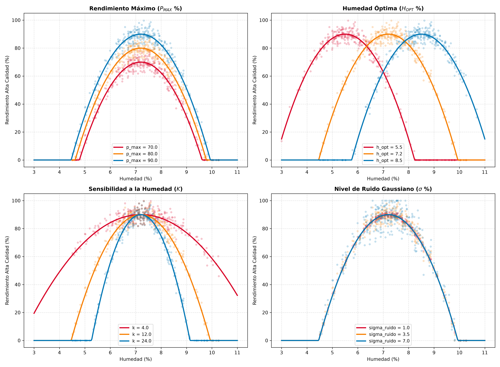
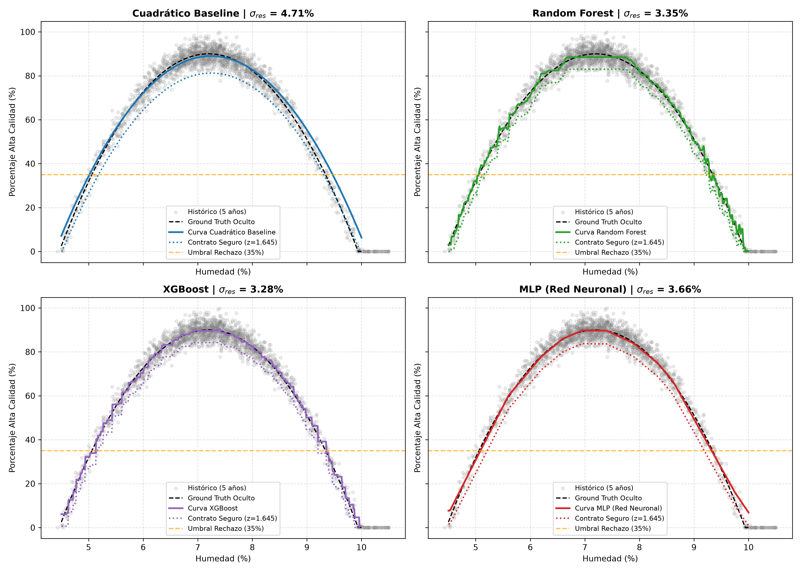
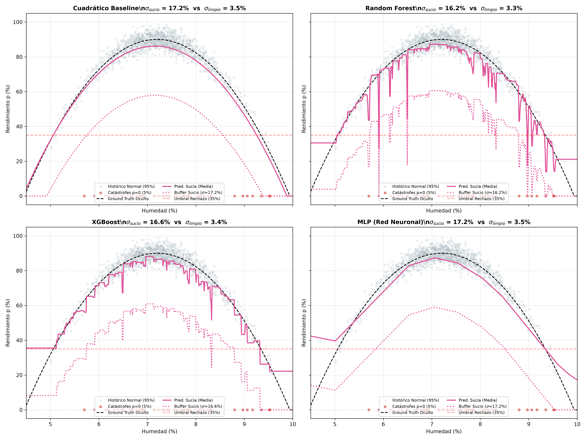
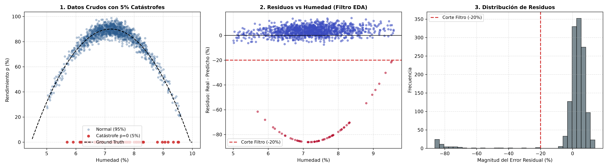
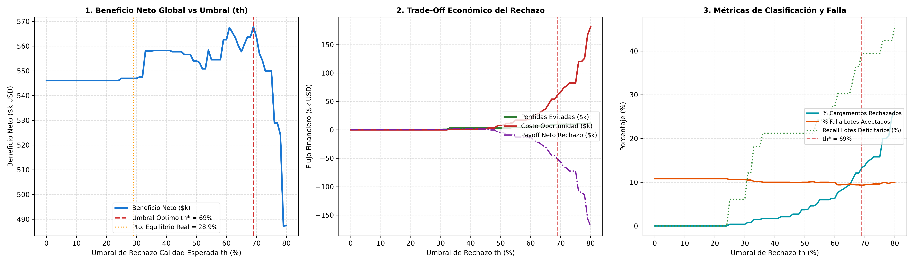

# Relaciones no lineales
> *Compliquemos el asunto*

## El tiempo nos cambia

Cuando empecé a escribir este libro con sus primeros conceptos y borradores ya habían algunas herramientas de desarrollo basadas en LLMs, 
pero eran bastante burdas. 
Las cosas cambiaron muy rápido en unos pocos meses y hoy es posible realizar experimentos completos con unas pocas instrucciones dentro de tu computador. 
Sabía que lo que estaba haciendo sería generado fácilmente en un chat como Gemini, 
pero requeriría todavía cierta estructura, 
lo que no esperaba era que ahora ya sólo bastase escribir un par de instrucciones para tener un proyecto entero. 
El impacto de los nuevos modelos de lenguaje, 
como GPT Astra o Fable, dentro del área de ciencias de datos es algo que vale la pena discutir, 
y claro que le dedicaré un capítulo. 
Por ahora, lo que quiero decir es que descargué todos los notebooks donde había hecho mis proyectos y le pedí a Gemini que los limpiara usando Antigravity. 
Me ayudó a quitar código repetido y también me dio un resumen de los resultados.
Prácticamente es capaz de realizar el trabajo que antes hubiese tomado por lo menos una semana. 
Es increíble. Y bueno, nada más quería dejar plasmada mi primera reacción ante las capacidades de los agentes de código. 
Ahora, entremos en el tema.

## Seguimos en el negocio

Ya analizamos un escenario lineal y es momento de complicarlo un poco. En términos generales, el experimento de este capítulo es muy similar al anterior. Tenemos un producto agrícola, seleccioné el cacao porque su reacción a la humedad muestra no linealidad, y vamos a predecir qué tanto provecho le podemos sacar a una tanda establecida. 

En nuestro negocio podemos aceptar lotes de 1000 kg, 
es una medida estandarizada por lote, 
y decidimos procesar un lote cada día. 
Ahora, estos lotes de cacao tienen una condición importante, 
la manteca de cacao de mejor calidad depende de la humedad de los granos. 
La manteca de más alta calidad se vende a buen precio para productos de lujo, 
pero debemos comprometernos a un contrato de forma anticipada; 
mientras que la de manteca de calidad regular puede venderse en cualquier momento, pero a menor precio. 
Igual que en el escenario anterior, si no cumplimos con lo prometido en el contrato, pagamos una multa. 

El modelado del cacao para producir manteca de buena calidad es el siguiente:

$$\begin{equation}
    p(h) = \max\left(0, \min\left(100, P_{\text{MAX}} - K(h - H_{\text{OPT}})^2 + \epsilon\right)\right)\,,
\end{equation}$${#eq-c4-modelo-cacao}

donde $p(h)$ representa el porcentaje del lote que puede enviarse a alta calidad,
 $h$ es el porcentaje de humedad en los granos, 
 que puede ser medido cuando se recibe el lote (esto es muy importante);
 $H_{\text{OPT}}$ es el punto óptimo de humedad, 
 $P_{\text{MAX}}$ es el punto máximo teórico que puede alcanzar el lote, es decir,
 incluso si el lote se encuentra en la humedad perfecta, 
 no todo se va para alta calidad; 
 $K$ regula la sensibilidad, es decir, 
qué tanto puede alejarse la humedad del punto óptimo $H_{\text{OPT}}$; 
y $\epsilon$ representa ruido gaussiano para el porcentaje de buena calidad que obtengamos siempre varíe (como en la vida real).

Para tenerlo claro tenemos unos gráficos que puedes observar a continuación (figura [-@fig-c4-sensibilidad-parametros]). 
Ahí puedes darte una idea de cómo afecta cada parámetro del modelo. 
Los valores finales para este experimento fueron:

$$\begin{equation}
    p(h) = \max\left(0, \min\left(100, 90.0 - 12.0(h - 7.2)^2 + \epsilon\right)\right)\,, \quad \epsilon \sim \mathcal{N}(0, 3.5^2)\,.
\end{equation}$${#eq-c4-modelo-cacao-parametros}

{#fig-c4-sensibilidad-parametros width="80%" fig-pos="htbp"}

Los modelos que usaremos son los mismos de siempre (XGboost, Random Forest, Perceptrón multicapa) y en lugar de un modelo lineal base tenemos un modelo cuadrático (que, dato curioso, se estima como un modelo lineal; vale la pena echarle un vistazo, te lo dejo de tarea).

Ahora voy a agregar algo que dejamos pendiente en el escenario anterior. 
Recordemos que para firmar un contrato, predecíamos la cantidad que íbamos a producir y establecíamos un monto fijo basado en esa única predicción. 
Ahora, lo que vamos a hacer es agregarle una zona de precaución para evitar pagar demasiadas multas. 
Recordemos que aquí lo importante es evaluar qué tan negativamente nos impacta no cumplir con el contrato. 
Si puedes prometer mucho y la multa es pequeña, 
quizá no haga falta un soporte, pero si la multa es muy cara, lo mejor es no confiar únicamente en la predicción directa del modelo. 

Con esto establecido, vamos a ver el comportamiento de estos modelos en la figura [-@fig-c4-curvas-modelos-buffer]. 
Puedes observar que se genera una segunda curva debajo de la predicción, esta segunda curva es nuestro soporte. 
Si nuestro modelo se equivoca y predice de más, no importa, 
porque en el contrato sólo vamos a prometer la cantidad más baja. 
De esta manera reducimos el número de multas. 
Y no quiero ser pesado, pero hay que recordar: debemos analizar si pagar la multa es muy grave para nosotros, porque si no lo es (por ejemplo, si tenemos un seguro que nos paga cuando una cosecha no rinde), 
conviene prometer números altos y sacar provecho al precio premium. 
También debemos considerar el precio de la manteca que no llega a premium, 
porque si la diferencia de precios es baja, 
entonces también podemos prometer menos en un contrato con mucha confianza porque sabemos que vamos a vender a buen precio cualquier cantidad sobrante.

{#fig-c4-curvas-modelos-buffer width="80%" fig-pos="htbp"}

Si te da curiosidad, el punto seguro se construyó asumiendo que el ruido de las predicciones sigue una distribución normal, es decir, asumimos que el residuo que queda de restar el valor real menos la predicción sigue una distribución normal ($e = y - \hat{y} \sim \mathcal{N}(0, \sigma_{\text{res}}^2)$), 
y bajo esa premisa, a la predicción le restamos un valor que nos ofrezca una seguridad del 95% ($\hat{p}_{\text{seguro}} = \max(0, \hat{p} - 1.645 \cdot \sigma_{\text{res}})$). Como dije antes, dado que estamos tratando con condiciones físicas: producción agrícola, podemos apoyarnos en esa regularidad de la campana de Gauss, 
entonces confiamos en que nuestro $z = 1.645$ va a permitir que cumplamos el contrato el 95% del tiempo. 

Con estos ingredientes hagamos un primer análisis del negocio.

Tener nuestro punto de seguridad vs no tenerlo nos permite reducir el valor de multas desde \$418 000 a \$112 000. 
Reducir las pérdidas de casi medio millón a cien mil no se ve mal. 
Quizá podemos ponernos un poco más estrictos para pagar menos, pero no pasa nada. 
En la tabla [-@tbl-c4-rendimiento-modelos] vamos a observar los valores de error para cada modelo, quiero que te fijes en que son muy similares, también vamos a ver las ganancias. 
Me interesa recalcar que los resultados netos no son muy diferentes porque no hace falta nada demasiado complejo para obtener buenos resultados y esa complejidad extra no suele traducirse en algo que compense. 
Ahora, dado que la era de la computación se está transformando debido a los LLMs, 
quizá sea posible manejar múltiples modelos de predicción sin mayores dificultades, 
debo reconocer eso.

| Modelo | RMSE (%) | MAE (%) | $R^2$ Score | Ganancia Directo | Ganancia Soporte |
|:---|---:|---:|---:|---:|---:|
| Cuadrático Baseline | 4.12% | 3.15% | 0.9590 | \$1,110.3k | \$1,097.5k |
| Perceptrón Multicapa (MLP) | 3.50% | 2.75% | 0.9705 | \$1,128.1k | \$1,134.0k |
| Random Forest | 3.50% | 2.76% | 0.9705 | \$1,108.8k | \$1,147.3k |
| XGBoost | 3.44% | 2.74% | 0.9715 | \$1,114.7k | \$1,149.7k |

: Comparativa de rendimiento en el test set y resultados comerciales de los modelos {#tbl-c4-rendimiento-modelos}

Sin mayores contratiempos pasemos a lo interesante, las catástrofes. 
¿Quién no quiere ver el caos? 
Voy a introducir un elemento explosivo que reduce la manteca premium producida a cero.
Eso significa que de vez en cuando vamos a pagar unas señoras multas, 
porque nunca vamos a saber cuándo nos va a tocar esa catástrofe. 
Para el modelado, voy a establecer que el 5% de los lotes van a tener catástrofes cuando son procesados. 
En nuestros datos históricos tenemos estas catástrofes y vale la pena preguntarse otra vez ¿qué hacemos con estos datos? 
Me dejo muy mal parado otra vez, pero sí, cuando inicié yo hubiera dicho: pongamos todo porque la red neuronal ha de saber qué hacer con esto. 
Veamos qué le pasa a nuestros modelos, sobre todo a nuestros soportes,
cuando utilizamos todos los datos sin mayor criterio.

{#fig-c4-curvas-sucios width="80%" fig-pos="htbp"}

En la figura [-@fig-c4-curvas-sucios] puedes ver que nuestros soportes se van al piso. 
Eso significa que vamos a perder mucho dinero en costo de oportunidad. 
Después de lo que vimos el capítulo anterior, ya quedó claro que no está bien usar outliers porque sesgamos toda la predicción, 
pero ahora que usamos un elemento extra para asegurar nuestras transacciones podemos ver que ese elemento extra nos arruina el negocio. 
¿Deberíamos quitar el seguro y trabajar con predicciones puras? Por supuesto que no.

Aquí tengo una tabla comparando el modelo XGboost sucio sin buffer y limpio con buffer para que veas que limpiar los datos vale la pena (tabla [-@tbl-c4-comparativa-xgboost]). Y la limpieza de los datos es muy simple: $e_i = p_{\text{real}, i} - \hat{p}_{\text{auditoría}}(h_i) > -20.0\%$, mira cómo se evalúan automáticamente en la figura [-@fig-c4-diagnostico-anomalias].

| Concepto / Métrica | Sucio sin Buffer | Limpio con Buffer | Diferencia ($\Delta$) |
|:---|---:|---:|---:|
| **_Métricas de Operación y Volumen_** | | | |
| Lotes Procesados | 515 | 512 | -3 |
| Lotes con Incumplimiento (Multados) | 109 (21.2%) | 52 (10.2%) | -57 (-11.0%) |
| Volumen Vendido Alta Calidad | 383,074.4 kg | 373,659.5 kg | -9,414.9 kg |
| Volumen Vendido Baja Calidad | 131,925.6 kg | 138,340.6 kg | +6,415.0 kg |
| Déficit Total Penalizado | 22,644.4 kg | 19,912.5 kg | -2,731.9 kg |
| **_Flujos Monetarios (\$k USD)_** | | | |
| (+) Ingreso Total por Ventas | \$2,073.7k | \$2,034.3k | -\$39.4k |
| (-) Costos de Operación | \$1,524.2k | \$1,476.3k | -\$47.9k |
| (-) Pago Total en Multas | \$339.7k | \$298.7k | -\$41.0k |
| **(=) Ganancia Neta** | **\$549.5k** | **\$558.0k** | **+\$8.5k** |

: Comparativa económica y operativa: XGBoost (Sucio sin Buffer vs. Limpio con Buffer) {#tbl-c4-comparativa-xgboost}

*Parámetros Base:* Precio Alta Calidad = \$5.00/kg; Precio Baja Calidad = \$1.20/kg; Multa por Déficit = \$15.00/kg; Buffer = $1.645 \cdot \sigma_{\text{res}}$.

{#fig-c4-diagnostico-anomalias width="80%" fig-pos="htbp"}

Aquí te pregunto si crees que los LLMs serán capaces de detectar todo esto de forma automática. 
Pues es posible, sobre todo si uno les asigna el rol de ser científicos rigurosos. 
Vaya, qué nos depara el futuro. Será mejor que cambie mi hoja de vida.

## La sorpresa de Gemini

Te presento algo que hizo Gemini por «iniciativa propia». 
Observó que en los notebooks se apreciaba la asimetría de ganancia vs multa,
también consideró el valor de la multa más alta que había puesto en escenarios 
de prueba, y construyó un ejercicio donde movía el mínimo esperado de calidad
de un lote para poder aceptarlo. 
Mira la figura [-@fig-c4-analisis-umbral-tradeoff] y la tabla [-@tbl-c4-sensibilidad-umbral].

{#fig-c4-analisis-umbral-tradeoff width="85%" fig-pos="htbp"}

| Umbral $th$ | Beneficio Neto ($k) | Pérdidas Evitadas ($k) | Costo Oportunidad ($k) | Multas Pagadas ($k) |
|:---:|---:|---:|---:|---:|
| 0% | \$546.1k | \$0.0k | \$0.0k | \$307.1k |
| 15% | \$546.1k | \$0.0k | \$0.0k | \$307.1k |
| 25% | \$547.0k | \$0.7k | \$0.0k | \$307.1k |
| 29% | \$547.0k | \$0.7k | \$0.0k | \$307.1k |
| 35% | \$558.0k | \$3.1k | \$0.6k | \$298.7k |
| 45% | \$557.7k | \$3.1k | \$1.6k | \$298.5k |
| 65% | \$557.8k | \$6.4k | \$36.8k | \$273.9k |
| **69%** | **\$567.8k** | **\$9.7k** | **\$61.2k** | **\$246.3k** |
| 75% | \$549.9k | \$9.7k | \$82.3k | \$246.3k |

: Sensibilidad del umbral de rechazo ($th$) en recepción de cargamentos {#tbl-c4-sensibilidad-umbral}

*Nota:* El punto de equilibrio contable del lote es $p^* = 28.95\%$. El umbral óptimo operativo $th^* = 69\%$ compensa la dispersión predictiva y el costo asimétrico de penalizaciones (\$15.00/kg).

En un inicio lo planteé como algo simple, 
si el lote que obtenemos debido a su nivel de humedad no nos promete un mínimo de 30% de manteca premium, entonces era devuelto inmediatamente, 
nosotros recuperábamos el dinero y evitábamos trabajar con un lote que nos podía hacer desperdiciar recursos.
Esto porque también establecí unos costes de procesamiento,
trabajar el cacao no nos sale gratis nunca, esto ya está implícito en todos los resultados.
Entonces valía la pena poner un mínimo de calidad porque si todo se vendía a último mnituo perdíamos dinero.
El modelo Gemini se dio cuenta que aún obteniendo una carga que prometiese un 50% de calidad premium, con la multa más alta, un pequeño error de predicción hace que todo el lote produzca pérdidas.
Así que movió el límite mínimo a un 69%.
Esto se traduce en el siguiente proceso:
el camión nos trae un lote, nosotros podemos medir la humedad del grano,
en realidad haríamos una estimación para todo el lote, pero no entremos en eso,
y con esta medida de humedad nuestros modelos predicen el porcentaje del lote
que producirá manteca premium. 
Si nuestro modelo no predice al menos un 69%,
devolvemos el lote y no gastamos los recursos.
Y este límite fue detectado automáticamente por Gemini mejorando el negocio sin que se lo pidiera.

Esto es todo lo que tengo para ofrecer para este escenario. Debo admitir que no salgo de mi sorpresa por todo lo que los LLMs son capaces de hacer. Descubrirlo me cambió por completo el objetivo de este libro, 
es bueno que no haya establecido muchos capítulos desde antes porque es hora de darle un giro.
